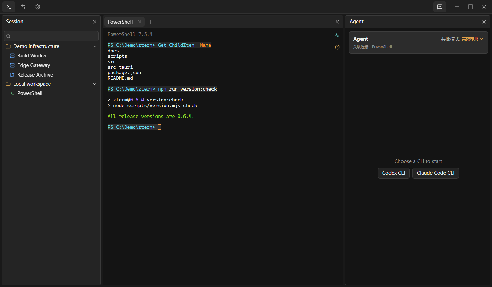
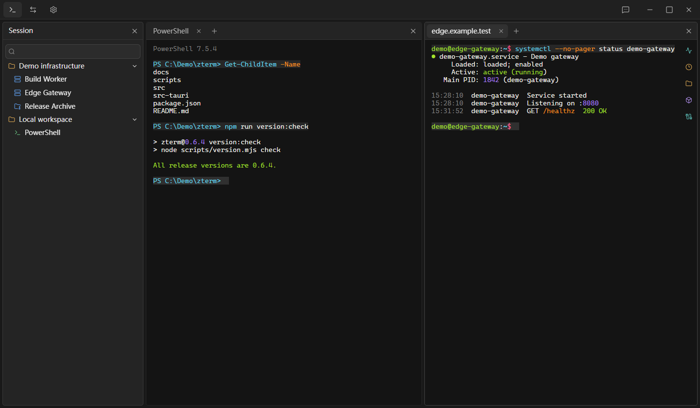
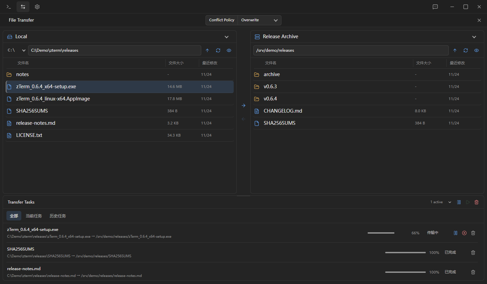
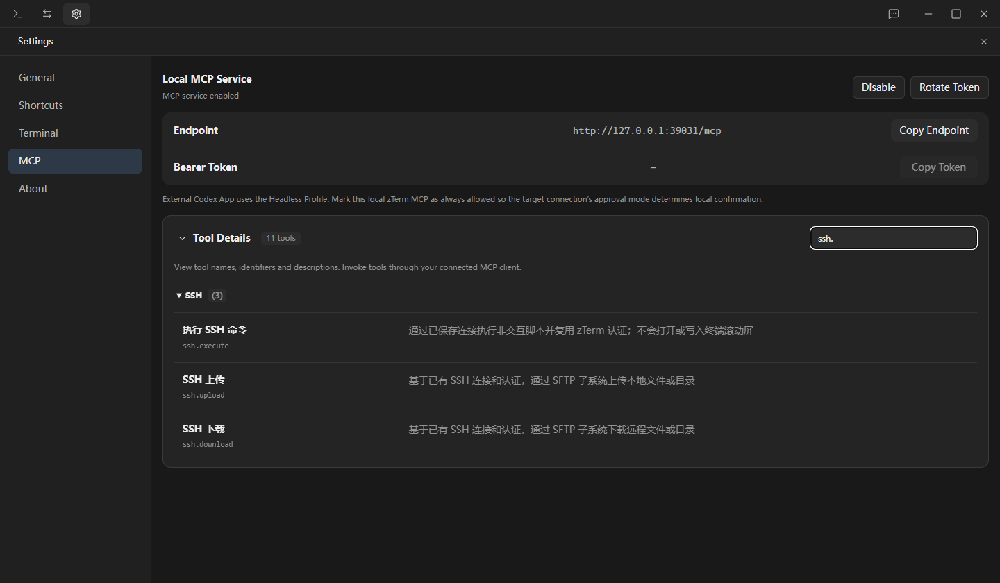

# zTerm

[简体中文](README.zh-CN.md) · [Download](https://github.com/lzmzzw/zTerm/releases/latest) · [Development docs](docs/README.md)

zTerm is a desktop workbench for SSH and local terminals. Keep saved connections within reach, work in tabs and splits, and browse remote files or check server resources without leaving the app. For AI-assisted work, open a locally installed Codex CLI or Claude Code CLI in the Agent sidebar.



## Download

Open [GitHub Releases](https://github.com/lzmzzw/zTerm/releases/latest) and choose an installer or package under **Assets** for your system: Windows x64 (NSIS `-setup.exe`), Linux x64 or Arm64, or macOS Arm64 (Apple silicon). `latest.json` and `.sig` files are for the updater, not manual installation. The latest published release may be behind this README, which describes the current source.

Already installed? Open **Settings → About** to check for updates. Platform signing and updater verification are separate; see [Build and release](#build-and-release).

## Work with sessions

1. Open **Sessions** from the title bar. Right-click the empty space in the session tree to create a connection or group. Save an SSH, local terminal, RDP, SFTP, or FTP session, then find it by name or browse its group.
2. Double-click a saved session to open it, or press Enter in the search box to open the first match. SSH and local sessions open as terminal tabs; SFTP and FTP open in **File Transfer**. RDP is Windows-only: zTerm keeps a tab for navigation, but the desktop opens in the system Remote Desktop client, not inside zTerm.
3. Arrange tabs in horizontal or vertical splits. The current layout is saved automatically and restored on launch. When no connections are open, zTerm can open the configured default local terminal.

The session tree sits on the left, with the terminal workspace in the center and tools on the right. The active terminal pane shows the tools available for that connection, including history, SFTP, monitoring, containers, and tunnels. **File Transfer** and **Settings** open as full pages; close the page to return to the workbench.



## Agent sidebar: Codex CLI and Claude Code CLI

With a local, SSH, or SSH container terminal active, open **Agent** from the title bar and choose a CLI you have already installed and signed in to. If an Agent is already running for that connection, zTerm shows it again without launching a duplicate. Hiding the sidebar keeps it running. Use the CLI's context menu to restart the same CLI or close it before switching. Each CLI uses its own login and model settings; zTerm does not manage model accounts or call models itself.

- **SSH and SSH container tabs:** zTerm automatically supplies a session-scoped **Visible Terminal Profile**. Commands and their output stay visible in the target terminal's scrollback. To work on another saved SSH connection, the Agent can open it in a new tab or split.
- **Local terminal tabs:** the CLI starts with its normal local configuration, without a zTerm-scoped MCP binding.
- **External MCP clients:** enable the local MCP service in **Settings → MCP** and use the **Headless Profile**. SSH execution and transfers run separately and return structured results without opening a terminal or reading or writing its scrollback. The endpoint is loopback-only and requires a bearer token. The service is not started at app launch by default.

On a scoped SSH launch, Claude Code uses a dedicated, stable local workspace. If Claude Code asks you to trust it the first time, review the prompt in the CLI; zTerm neither grants trust nor skips Claude Code's permission checks. The scoped launch excludes user and project instructions, disables built-in tools, skills, and automatic memory, and loads only the session's zTerm MCP. Codex uses a per-session workspace and a read-only local sandbox, with the local shell tool and other MCP servers disabled. These restrictions do not apply to CLI launches from local terminal tabs.

### Connection approvals

Approval follows the **target saved SSH connection's current setting**, not the CLI selected in the sidebar.

| Mode | What zTerm does |
| --- | --- |
| Approve Every Call | Requests local confirmation for every tool call governed by the connection. |
| Efficient Approval (default) | Runs inspections, transfers, and routine operations automatically; asks before high-risk or irreversible actions. Risk classification is heuristic, not a guarantee. |
| Full Automation | Adds no risk confirmation, including for writes and deletes. Use it only for connections you trust. Tool restrictions and audit records still apply. |

When a call needs confirmation or local authentication input, zTerm opens the approval panel. Review the target and operation there; the result returns to the original MCP call. Do not send the operation again. If the client received a pending receipt instead, wait for that invocation with `approval.wait`. Missing authentication input must still be entered locally in every mode. See the [MCP and approval contract](docs/api-contract.md#agent-侧栏与-mcp-审批) for details.

## Terminals, files, and settings

- **Terminals:** zTerm uses native SSH and renders local and remote terminals with xterm. Search, copy, and resend commands from history scoped to the session or local profile. SSH tools include resource snapshots for CPU, memory, disks, load, uptime, and network activity, plus support for jump hosts, tunnels, and container shells.
- **Files:** browse remote directories, create folders, rename and delete entries, and upload or download files. **File Transfer** shows the source and destination side by side, with a task list for progress and retries. Use SFTP for sensitive connections: FTP does not encrypt credentials or file contents. Supported terminal sessions can also use `rz`/`sz` with remote `lrzsz` installed.
- **Settings:** change appearance, language, shortcuts, terminal profiles, and the default local terminal. The **MCP** page manages the local endpoint and lists available tools; calls are made by a connected client. **About** shows the version and checks for updates.





**Vim and scrollback.** In ordinary terminals, dragging past the viewport or scrolling while holding the left button extends the selection. New local sessions and reconnected standard POSIX SSH sessions enable Vim's `mouse=a` for cross-screen file selection without modifying Vim configuration or sending keys to a running Vim. With no button held, plain vertical wheel input in an alternate-screen app moves the cursor one line at a time; the Agent sidebar is unchanged. If automatic setup does not apply (for example, in a container, on Windows SSH, or when the shell overrides initialization), use `:set mouse=a` in Vim. See the [engineering notes](docs/engineering.md) for the full list of exceptions.

**Windows Explorer.** The installed app adds an **Open with zTerm** (`通过zTerm打开`) entry for folders, folder backgrounds, and drives. On Windows 11 it may be under **Show more options**. You can also type `zterm` into Explorer's address bar. The installer registers App Paths without changing the global `PATH`. The default local terminal opens in that directory, in a new tab if zTerm is already running. Launches without arguments can also use the caller's working directory, including one set by a shortcut; temporary directory sessions are not restored after restart.

## Development

Install Node.js 22.13 or newer, npm, stable Rust, and the [Tauri system prerequisites](https://v2.tauri.app/start/prerequisites/). On Windows, use the `x86_64-pc-windows-msvc` target and Visual Studio C++ Build Tools.

```bash
npm ci
npm run check
npm run version:check
```

- **Desktop development:** `npm run tauri:dev` on Windows, or `npm run tauri -- dev` on Linux and macOS.
- **Browser-only UI work:** `npm run dev:browser` explicitly enables the Vite Tauri mock. `npm run dev` serves the frontend without that mock. Neither the mock nor frontend tests validate native terminals, SSH/SFTP, real file dialogs, or OS integration; test these in the desktop app.
- **Rust checks:** on Windows use `npm run test:rust` and the MSVC wrapper for format and Clippy checks. Elsewhere run `cargo fmt --check` and `cargo test` from `src-tauri`. See the [engineering guide](docs/engineering.md#本地检查) for the full commands and native verification boundaries.

## Build and release

On Windows, `npm run tauri:build` creates a local NSIS installer, with updater artifact generation disabled. `npm run tauri:release` builds the release NSIS package with updater signatures and requires `TAURI_SIGNING_PRIVATE_KEY`; it does not publish. Neither command builds an MSI. On Linux and macOS, use the [Release workflow](.github/workflows/release.yml) as the reference for dependencies and target arguments.

For a release, sync versions with `npm run version:set -- <version>`, run `npm run version:check`, then push the matching `v<version>` tag. GitHub Actions runs **Check** before building and publishing the four platform targets, along with updater signatures and `latest.json`.

| Signature | Current release workflow |
| --- | --- |
| OS code signing | Windows NSIS installers are not Authenticode-signed. macOS uses an ad-hoc signature, not a Developer ID signature, and is not notarized. The OS may show security prompts. |
| Tauri updater signing | Release update artifacts are signed with the updater key; zTerm verifies them with its bundled public key. This does not provide OS code signing or notarization. |

## Security notes

- Saved connection secrets go into the OS keyring, not plaintext SQLite rows. Native SSH records an unknown host key on first connection and rejects changes to a known key. Verify the identity of new servers and keep real host details, credentials, and smoke-test environment files out of Git, screenshots, and docs. Never pass passwords, private keys, or tokens as MCP tool arguments.
- Windows RDP file signing is separate from installer and updater signing. Set `ZTERM_RDP_SIGNING_CERT_THUMBPRINT` to the 40-character thumbprint of a code-signing certificate available to the current user, then restart zTerm. zTerm calls `rdpsign.exe` before opening `mstsc.exe`; missing or invalid configuration or a signing failure falls back to opening the unsigned RDP file.

## License

zTerm is licensed under the GNU General Public License version 3.0 only (`GPL-3.0-only`). See [LICENSE](LICENSE) and [THIRD_PARTY_NOTICES.md](THIRD_PARTY_NOTICES.md).
