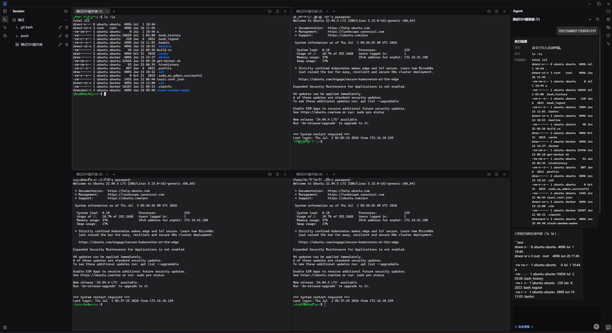
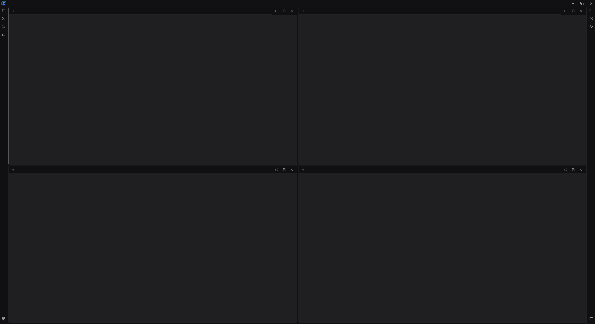
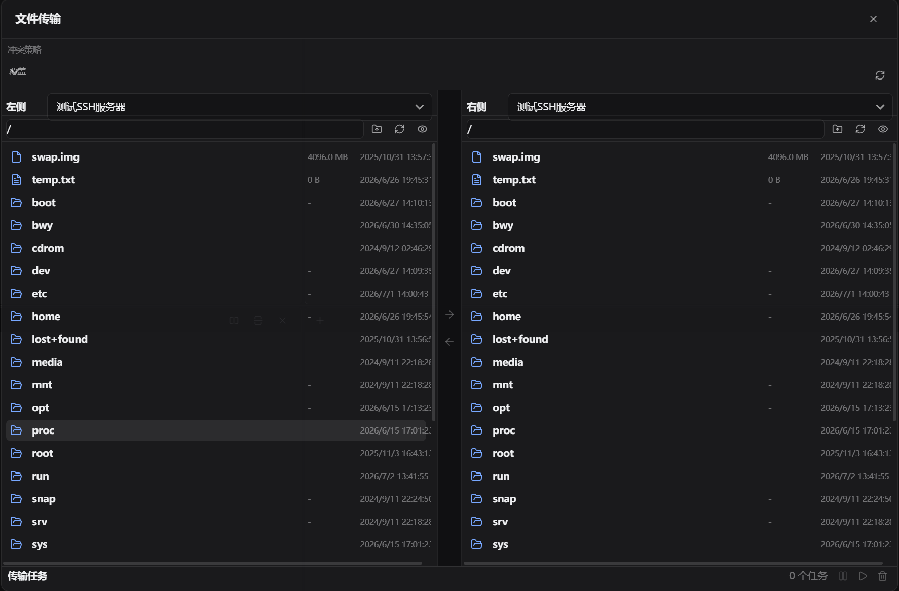
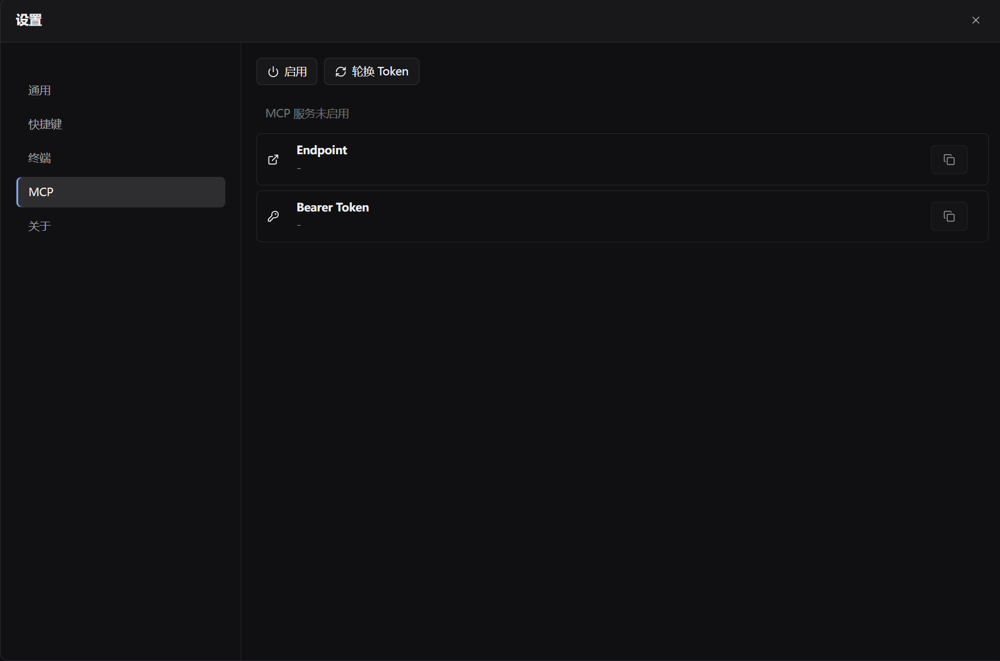

# zTerm

[English](README.md)

zTerm 是一个基于 Tauri 的桌面终端工作台，面向 SSH、SFTP、命令历史、服务器监控和 Codex 辅助运维场景。界面采用高密度工作区布局：左侧管理会话，中间使用分栏终端，右侧提供文件、历史、监控和 Codex CLI。



## 功能特性

- 保存、搜索、分组并打开 SSH/RDP/本地终端会话，以及 FTP/SFTP 文件传输会话。
- SSH 会话通过系统 OpenSSH 客户端运行，并由 xterm 渲染输入输出。
- 支持终端标签、横向/纵向分栏和工作区恢复。
- 支持 SFTP 目录浏览、新建目录、上传、下载、重命名、删除和失败重试。
- 按会话或本地终端 profile 捕获命令历史，支持搜索、复制和重新发送。
- 连接凭据写入操作系统 keyring，避免以明文保存在 SQLite 中。
- 右侧 Agent 面板直接启动本机已登录的 Codex CLI；每个终端标签独立绑定一个 Codex 进程，切回已有标签时恢复显示。
- 侧栏 Codex 使用 Visible Terminal Profile：所有服务器命令和输出都进入 zTerm 滚动屏；需要多服务器协作时，可在新标签或横向/纵向分屏中打开其他已保存 SSH 连接并分别操作。
- 外部 Codex App 使用 Headless Profile：通过独立 SSH 执行和文件传输返回结构化结果，不打开、读取或写入终端滚动屏。
- 默认“高效审批”自动放行巡检、文件传输和常规运维，仅高风险或不可逆操作在 zTerm 中确认；Codex 客户端信任 zTerm 工具，由 zTerm 作为唯一最终审批点，避免双重审批。
- 支持 SSH 服务器 CPU、内存、磁盘、负载、运行时间和网络流量快照监控。

RDP 会话通过 Windows 系统远程桌面客户端在外部窗口中打开；工作区保留会话标签用于定位，但不内嵌或渲染远程桌面。侧栏 Agent 完全由本机 Codex CLI 实现，使用 Codex CLI 的登录态和模型配置；zTerm 不提供模型管理、内置模型调用，也不保存或代理 Codex 账号凭据。

## 界面截图







## 环境要求

- Node.js `>=22.13`
- npm
- Rust stable toolchain
- 平台对应的 Tauri 系统依赖

Windows 构建建议使用 `x86_64-pc-windows-msvc` Rust target 和 Visual Studio Build Tools。

## 开发命令

```bash
npm install
npm run dev
npm run dev:browser
npm run quality:check
npm run typecheck
npm run test:frontend
npm run build
```

`npm run dev:browser` 仅用于普通浏览器中的界面开发和视觉回归。它通过 Vite `browser` mode 显式启用轻量 Tauri Mock；默认 `npm run dev`、生产构建和真实 Tauri 运行态均不会启用。Mock 只覆盖启动与只读界面所需命令，原生终端、SSH/SFTP、文件和系统能力仍需在 Tauri/WebView2 中验证。

`npm run quality:check` 检查前端 IPC 单一入口、基础层/feature/app 依赖方向、Tauri command 跨文件重复所有权和无外部引用的导出；`npm run check` 已包含该门禁。

Rust 和 Tauri 检查：

```bash
cd src-tauri
cargo fmt --check
cargo test
```

桌面安装包构建：

```bash
npm run tauri:build
```

## 发布

推送版本 tag 后，GitHub Actions 会自动构建 release 产物：

```bash
git tag v0.1.0
git push origin v0.1.0
```

发布 workflow 会构建四类目标：

- Windows x64
- Linux x64
- Linux Arm64
- macOS Arm64

未签名的 macOS 和 Windows 产物可能触发系统安全提示。后续可以通过 GitHub Actions 配置 Tauri 签名密钥来补充代码签名。

## 安全说明

不要提交真实主机、用户名、密码、API Key、私钥、token 或 smoke 测试环境文件。本地 Agent 设置、内部项目说明、构建产物、运行时数据库和临时凭据默认会被忽略。

Windows 下可将 `ZTERM_RDP_SIGNING_CERT_THUMBPRINT` 设置为当前用户可用代码签名证书的 40 位 Thumbprint，修改环境变量后需重启 zTerm。zTerm 会在启动 `mstsc.exe` 前调用 `rdpsign.exe`；配置缺失、格式无效或签名失败时保持兼容，继续使用原有未签名 RDP 启动流程。

## 许可证

zTerm 使用 GNU General Public License version 3.0 only。详见 [LICENSE](LICENSE)。

第三方说明见 [THIRD_PARTY_NOTICES.md](THIRD_PARTY_NOTICES.md)。
