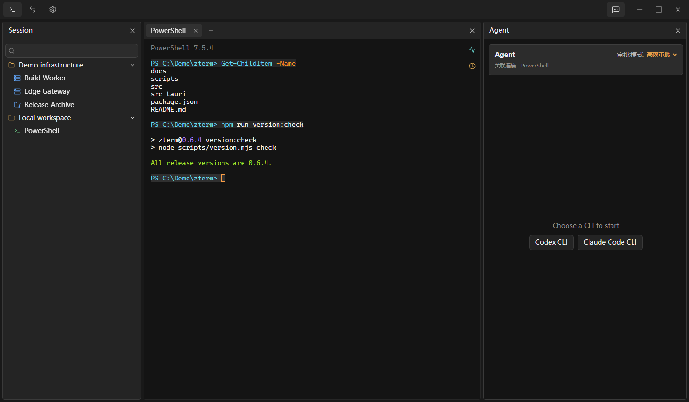
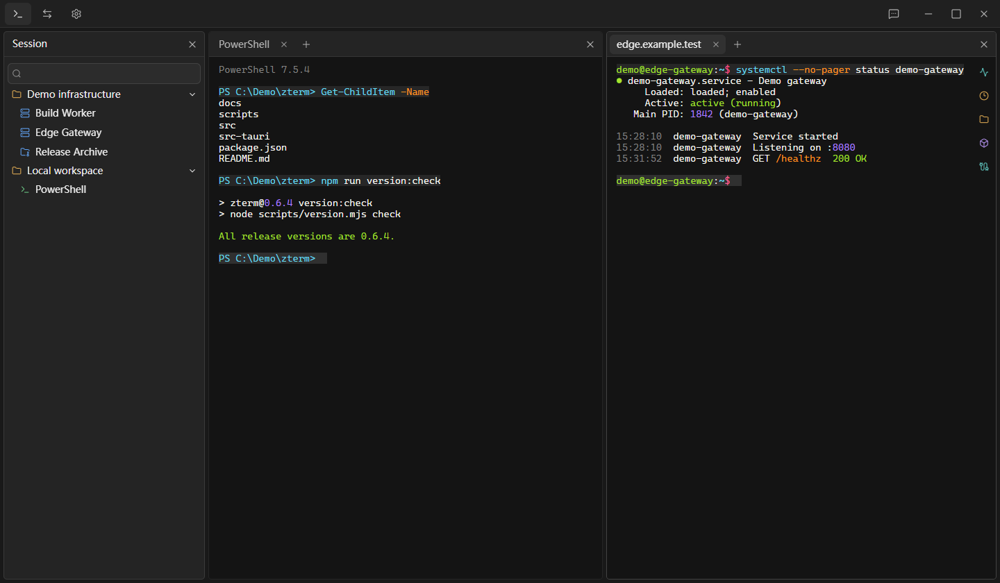
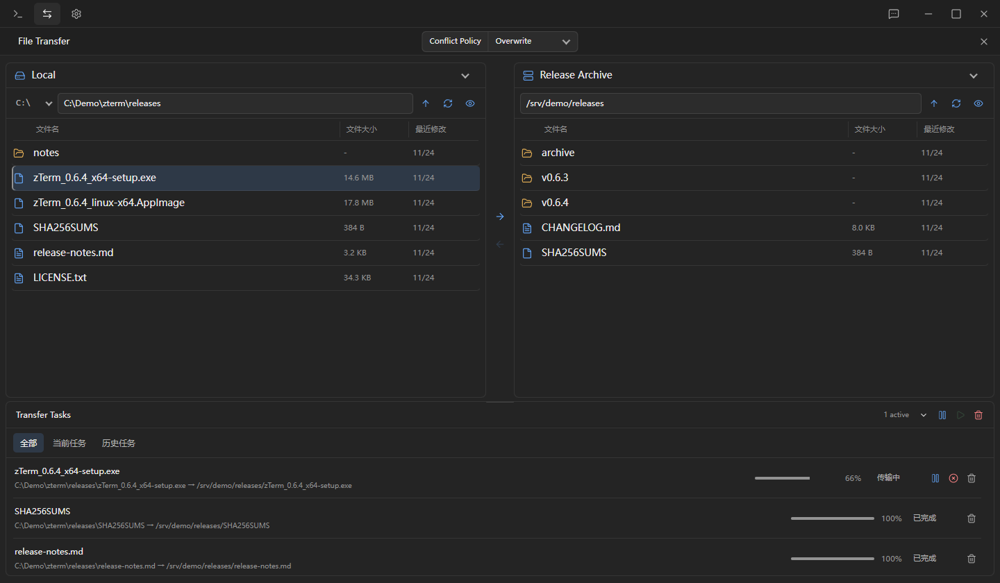
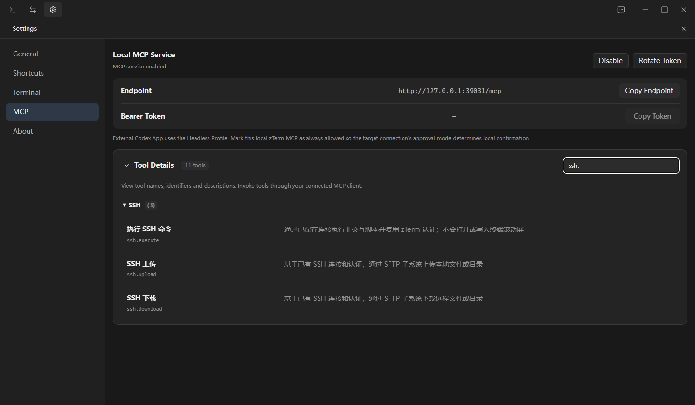

# zTerm

[English](README.md) · [下载安装](https://github.com/lzmzzw/zTerm/releases/latest) · [开发文档](docs/README.md)

zTerm 是一个桌面终端工作台。常用 SSH 和本地会话可以保存在同一处，用标签和分屏并排操作，也能直接浏览远程文件、查看服务器资源。需要 AI 辅助时，可在 Agent 侧栏启动本机的 Codex CLI 或 Claude Code CLI。



## 下载安装

打开 [GitHub Releases](https://github.com/lzmzzw/zTerm/releases/latest)，在 **Assets** 中按系统和架构选择安装包：Windows x64（NSIS `-setup.exe`）、Linux x64 / Arm64，或 macOS Arm64（Apple 芯片）。`latest.json` 和 `.sig` 文件供更新器使用，不是手动安装包。本文以当前源码为准，最新发布版可能尚未包含部分功能。

已安装 zTerm 时，可在**设置 → 关于**检查更新。系统代码签名与更新包校验是两回事，详见[构建与发布](#构建与发布)。

## 使用会话

1. 从标题栏打开**会话**，在会话树空白处右键新建连接或分组。可保存 SSH、本地终端、RDP、SFTP 和 FTP 会话，之后按名称搜索或从分组中找到它们。
2. 双击会话打开，或在搜索框按 Enter 打开第一个结果。SSH 和本地会话进入终端标签，SFTP 和 FTP 进入**文件传输**。RDP 仅在 Windows 上使用：zTerm 保留会话标签供切换定位，远程桌面在系统客户端中打开，不嵌入 zTerm。
3. 用横向或纵向分屏并排摆放终端标签。当前布局会自动保存，下次启动时恢复。没有打开的连接时，zTerm 可打开已配置的默认本地终端。

左边是会话树，中间是终端，右边是工具面板。当前分栏的终端内会按连接类型显示历史、SFTP、监控、容器和隧道等入口。**文件传输**和**设置**独立成页，关闭页面即可回到工作台。



## Agent 侧栏：Codex CLI 与 Claude Code CLI

先激活本地、SSH 或 SSH 容器终端，再从标题栏打开 **Agent**，选择已安装并登录的 CLI。当前连接已有 Agent 时会回到原来的 CLI，不会重复启动；收起侧栏也不会停止它。可以通过右键菜单重启同一种 CLI，或先关闭再切换。CLI 沿用自己的登录状态和模型设置，zTerm 不管理模型账号，也不直接调用模型。

- **SSH 和 SSH 容器标签：**zTerm 自动为本次 CLI 会话配置 **Visible Terminal Profile（可见终端）**。命令和输出留在目标终端的滚动记录里；需要操作其他已保存的 SSH 连接时，可在新标签或分屏中打开它。
- **本地终端标签：**CLI 沿用自己的本地配置，zTerm 不注入专用 MCP。
- **外部 MCP 客户端：**在**设置 → MCP**启用本机服务后，可使用 **Headless Profile（无界面）**。SSH 执行与文件传输独立运行，返回结构化结果，不打开终端，也不读写终端滚动记录。服务只监听回环地址，使用 Bearer token 鉴权，默认不随应用启动。

从 SSH 侧栏启动时，Claude Code 使用专用且固定的本地工作目录。首次若出现目录信任提示，请在 CLI 中核对后自行决定；zTerm 不预置信任，也不跳过 Claude Code 的权限检查。这种启动方式不加载用户和项目指令，停用内置工具、Skill 和自动记忆，只加载本次会话的 zTerm MCP。Codex 则使用每次会话独立的工作目录和只读本地沙箱，禁用本地 Shell 工具及其他 MCP。以上限制不适用于从本地终端标签启动的 CLI。

### 连接审批

审批使用**目标 SSH 连接当前保存的设置**，与侧栏选择哪种 CLI 无关。

| 模式 | zTerm 如何处理 |
| --- | --- |
| 每次批准 | 受该连接策略约束的每次工具调用都要在本地确认。 |
| 高效审批（默认） | 巡检、传输和常规操作自动执行；高风险或不可逆操作需要确认。风险分类是启发式判断，可能有遗漏。 |
| 完全自动 | 写入、删除等操作不再由 zTerm 追加风险确认，仅用于可信连接。工具范围仍受限，执行仍留审计记录。 |

需要批准或补充本地认证输入时，zTerm 会打开审批面板。请在那里核对目标和操作，结果会返回原 MCP 调用，不要重发操作。如果客户端先收到待审批回执，用 `approval.wait` 等待同一次调用。任何模式下，缺少的认证信息仍需在本地输入。细节见 [MCP 与审批契约](docs/api-contract.md#agent-侧栏与-mcp-审批)。

## 终端、文件与设置

- **终端：**zTerm 通过原生 SSH 连接，在 xterm 中呈现本地与远程终端。命令历史按会话或本地终端配置保存，可搜索、复制并重新发送。SSH 支持跳板、隧道和容器终端，也可查看 CPU、内存、磁盘、负载、运行时间和网络流量快照。
- **文件：**可浏览远程目录、新建文件夹、重命名、删除、上传和下载。**文件传输**页并排显示源端与目标端，任务列表可查看进度和重试。敏感连接请用 SFTP：FTP 不加密账号、密码和文件内容。受支持的终端也可使用 `rz`/`sz`，远端须安装 `lrzsz`。
- **设置：**可调整外观、语言、快捷键、终端配置和默认本地终端。**MCP** 页用于管理本机服务和查看工具目录，工具由已连接的客户端调用。**关于**页可查看版本和检查更新。





**Vim 与终端历史。** 在普通终端里，拖出可视区域或按住左键滚动，可继续扩展选区。新开本地会话或重连标准 POSIX SSH 会话后，zTerm 会为 Vim 启用 `mouse=a`，方便跨屏选取文件内容，不改 Vim 配置，也不向正在运行的 Vim 注入按键。在普通终端的备用屏幕中，不按左键使用垂直滚轮时，光标每次移动一行；Agent 侧栏不受影响。容器、Windows SSH、Shell 覆盖初始化等情况下如果未自动启用，可在 Vim 中执行 `:set mouse=a`。完整例外见[工程说明](docs/engineering.md)。

**Windows 资源管理器。** 安装版在文件夹、文件夹空白处和驱动器的右键菜单添加「通过zTerm打开」，Windows 11 中可能位于「显示更多选项」。也可在地址栏输入 `zterm`。安装程序通过 App Paths 注册，不修改全局 `PATH`。zTerm 会在对应目录打开默认本地终端，应用已运行时打开新标签。无参数启动也可沿用调用方的工作目录，包括快捷方式指定的目录；重启后不恢复这种临时会话。

## 开发

需要 Node.js 22.13 或以上、npm、稳定版 Rust，以及对应平台的 [Tauri 系统依赖](https://v2.tauri.app/start/prerequisites/)。Windows 使用 `x86_64-pc-windows-msvc` target 和 Visual Studio C++ Build Tools。

```bash
npm ci
npm run check
npm run version:check
```

- **桌面开发：**Windows 用 `npm run tauri:dev`，Linux 和 macOS 用 `npm run tauri -- dev`。
- **浏览器界面开发：**`npm run dev:browser` 显式开启 Vite 的 Tauri Mock，`npm run dev` 启动前端开发服务器但不启用 Mock。Mock 和前端测试不能验收原生终端、SSH/SFTP、系统文件对话框或操作系统集成，这些应在桌面应用中验证。
- **Rust 检查：**Windows 用 `npm run test:rust`，并通过 MSVC 包装脚本执行格式检查和 Clippy；其他平台进入 `src-tauri` 后运行 `cargo fmt --check` 和 `cargo test`。完整命令和原生验收范围见[工程说明](docs/engineering.md#本地检查)。

## 构建与发布

Windows 上，`npm run tauri:build` 生成供本地验证的 NSIS 安装包，不生成 updater 产物；`npm run tauri:release` 使用正式配置生成带 updater 签名的 NSIS 包，需要 `TAURI_SIGNING_PRIVATE_KEY`，但不会发布。两者均不生成 MSI。Linux 和 macOS 的构建依赖及目标参数见 [Release 工作流](.github/workflows/release.yml)。

发布时先用 `npm run version:set -- <version>` 同步版本，再执行 `npm run version:check`，然后推送对应的 `v<version>` tag。GitHub Actions 先运行 **Check**，通过后构建并发布上述四个平台目标的安装包、更新签名和 `latest.json`。

| 签名 | 当前发布工作流 |
| --- | --- |
| 操作系统代码签名 | Windows NSIS 安装包未做 Authenticode 签名；macOS 使用临时签名（ad hoc），没有 Developer ID 签名，也未公证。系统可能显示安全提示。 |
| Tauri 更新签名 | 正式更新产物使用 updater 私钥签名，zTerm 用内置公钥校验。它不提供操作系统代码签名或公证。 |

## 安全说明

- 保存的连接密钥和密码等敏感信息由系统 keyring 管理，不以明文写入 SQLite。原生 SSH 会在首次连接时记录未知主机的密钥，已知密钥发生变化时拒绝连接。新连接请先核对服务器身份。不要将真实主机信息、凭据或 smoke 测试环境文件放入 Git、截图或文档，也不要把密码、私钥或 token 作为 MCP 工具参数传递。
- Windows RDP 文件签名独立于安装包签名和 updater 签名。将 `ZTERM_RDP_SIGNING_CERT_THUMBPRINT` 设为当前用户可用代码签名证书的 40 位指纹，再重启 zTerm。zTerm 在启动 `mstsc.exe` 前调用 `rdpsign.exe`；配置缺失、无效或签名失败时，仍以未签名的 RDP 文件打开。

## 许可证

zTerm 采用 GPL 第 3 版，不适用后续版本（`GPL-3.0-only`）。详见 [LICENSE](LICENSE) 和[第三方声明](THIRD_PARTY_NOTICES.md)。
